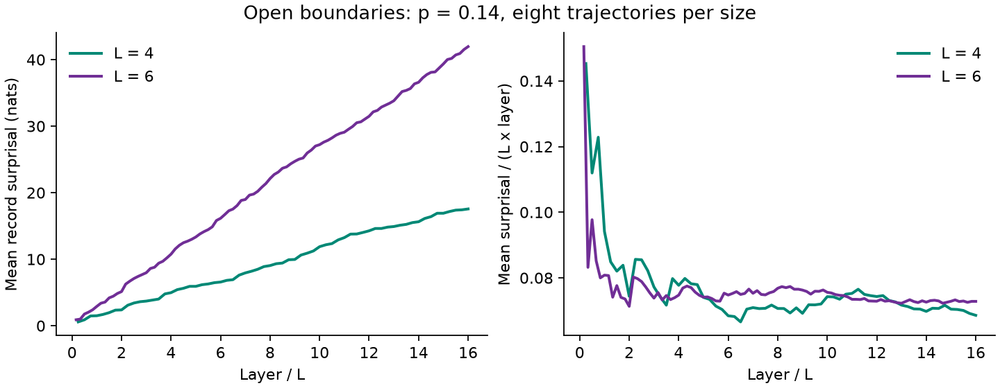

# Boundary Transfer Matrix: Dual-Haar Circuits

[](https://github.com/ka784-jpg/Boundary-Transfer-Matrix/actions/workflows/tests.yml)
[](LICENSE)

Research-code archive and small statevector examples for the **dual-Haar
contribution, Figures 6, 7, and 12**, to the paper below. This repository is
scoped to Kemal Aziz's contribution; it is not the codebase for all coauthors'
Clifford and measurement-only calculations.

**Paper:** Abhishek Kumar, Kemal Aziz, Ahana Chakraborty, Andreas W. W. Ludwig,
Sarang Gopalakrishnan, J. H. Pixley, and Romain Vasseur,
[*Boundary transfer matrix spectrum of measurement-induced transitions*](https://arxiv.org/abs/2310.03078v2),
Phys. Rev. B **109**, 014303 (2024).
[Published article](https://doi.org/10.1103/PhysRevB.109.014303).

[Run an example](#quickstart) | [Figures 6, 7, 12](docs/RESULTS.md) | [Code interfaces](docs/CODE.md) | [Reproducibility](docs/REPRODUCIBILITY.md)


**What the calculation probes.** The probability of a measurement record defines
a free-energy-like observable. Its size dependence with open or dissipative
boundaries probes the associated critical theory. This is **published Figure 6**,
not a fit produced by the quickstart.

**Recovery status:** the original open-boundary statevector source has been
recovered and tested through a small driver. The original boundary-dephasing
statevector Monte Carlo campaign for Figures 7 and 12 has **not yet been located**.
Those figures are documented as published results, not as currently reproducible
outputs of this repository. No replacement engine is presented as historical code.

## Quickstart

Install [Julia 1.12](https://julialang.org/downloads/) and clone this repository.
Run from its root:

```sh
julia --project=. -e 'using Pkg; Pkg.instantiate()'
julia --project=. --startup-file=no examples/quickstart.jl results/first-run
julia --project=. --startup-file=no tests/runtests.jl
```

This runs eight short open-boundary trajectories each at L=4 and L=6, with
p=0.14 and 16L gate-plus-measurement layers. It records cumulative measurement
surprisal in nats and its normalization per site and layer. Output includes
the source hash and seed rule. Existing output directories are refused.
First-time installation and compilation can take several minutes.



Optional plot, with Python 3.12 or newer:

```sh
python -m pip install -r examples/requirements.txt
python examples/plot.py results/first-run results/first-run/trace.png
```

[Saved example outputs](examples/expected/) are from Julia 1.12.6.
Eight trajectories are a demonstration, **not** an estimate of the central charge
or boundary scaling dimension. The quickstart does not apply a boundary
dephasing channel or perform Monte Carlo extrapolation.

## Published Contribution

| Figure 6 | Figure 7 | Figure 12 |
| --- | --- | --- |
| [](docs/RESULTS.md#figure-6-open-boundary-free-energy) | [](docs/RESULTS.md#figure-7-boundary-dissipation) | [](docs/RESULTS.md#figure-12-monte-carlo-convergence) |

## Reliability and Scope

- Original [simulation source](research/open_boundary_haar.jl) is preserved
  byte-for-byte, with its origin and hash in [the manifest](docs/source_manifest.json).
- Tests cover gate and dual unitarity, dense gate application, measurement-record
  probabilities, norm preservation, seeded repeatability, and safe output handling.
- Dense statevector memory grows as 2^L. The example API caps L at 10 and is serial,
  because the archival kernel uses mutable global state.
- Production ensembles, historical seeds, all fitting scripts, and the full
  Figures 7/12 implementation are not included. See [reproducibility](docs/REPRODUCIBILITY.md).

Code is [MIT licensed](LICENSE) with the owner's authorization. Paper figures
are excluded from MIT and retain their original rights and
[attribution](docs/figures/README.md). Please cite the full coauthor paper.
