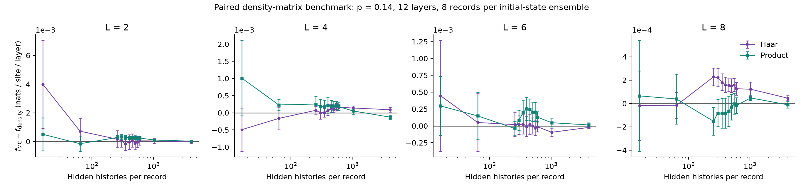

# Reproducibility and Validation

[Overview](../README.md) | [Method](METHOD.md) | [API](CODE.md)

## Run the Checks

```sh
julia --project=. -e 'using Pkg; Pkg.instantiate()'
julia --project=. --startup-file=no tests/runtests.jl
julia --project=. --startup-file=no examples/dephasing.jl examples/validation.toml results/validation
python -m pip install -r examples/requirements.txt
python examples/plot_dephasing.py results/validation results/validation/convergence.png
python tests/integrity.py --plots
```

The pinned Julia environment targets 1.12.6. Tests use physical invariants and
same-process seeded repeatability, not cross-platform bitwise equality.

## Independent Reference Calculations

The statevector engine updates four amplitudes at a time. The reference instead
constructs sparse Kronecker gate operators and evolves a full density matrix.
It applies boundary dephasing directly to matrix blocks rather than sampling
hidden jumps. Both receive identical gates, initial states, and observed records.

Tests compare every prefix likelihood with an exhaustive sum of all hidden
histories for L=2,4,6,8, both initial-state families, p=0,0.14,0.7,1, and both
open and dissipative boundaries. Other checks cover analytical channels,
measurement probabilities, state normalization, underflow-safe likelihoods,
impossible records, finite-sample diagnostics, and synthetic known-fit data.

The [saved benchmark](../examples/dephasing_expected/) uses 64 independent
circuit/record cases: four sizes, two initial-state families, eight records each.
It compares exhaustive sums against density matrices at all 12 layer prefixes,
and Monte Carlo at counts from 16 to 4,096. The maximum exact log-probability
discrepancy was **3.56e-15**, recorded in `metadata.toml`.
Sampling error is displayed as paired differences,
so variation between unrelated records does not obscure the comparison.



## What the Outputs Mean

- `records.csv`: per-record free energy, final log likelihood, relative sampling
  error, effective sample size, and exhaustive-reference discrepancy.
- `convergence.csv`: ensemble means and standard errors at each sample count,
  including paired MC-minus-density errors.
- `extrapolation.csv`: fourth-order inverse-count fit and bootstrap diagnostics.
- `metadata.toml`: complete configuration, runtime, seed rules, and code hashes.

Checkpoints share cumulative hidden samples. Bootstrap resampling therefore
uses whole independent record curves, not individual checkpoint values.
Product and Haar ensembles are processed separately. Their equal-weight combined
standard error is one half of the quadrature sum when the ensembles are independent.

## Scope of Reproduction

The short benchmark tests the implementation, not steady-state finite-size
scaling. Eight records per ensemble cannot resolve published high-precision
free energies, central charges, or boundary dimensions. Production studies
require much larger ensembles, equilibration checks, size and time convergence,
and stable fits under changes in the sample-count and size windows.

The repository includes the numerical methods and published figure assets;
the original full production datasets and exact campaign seeds are not bundled.
Published figures are labeled separately from executable example outputs.
