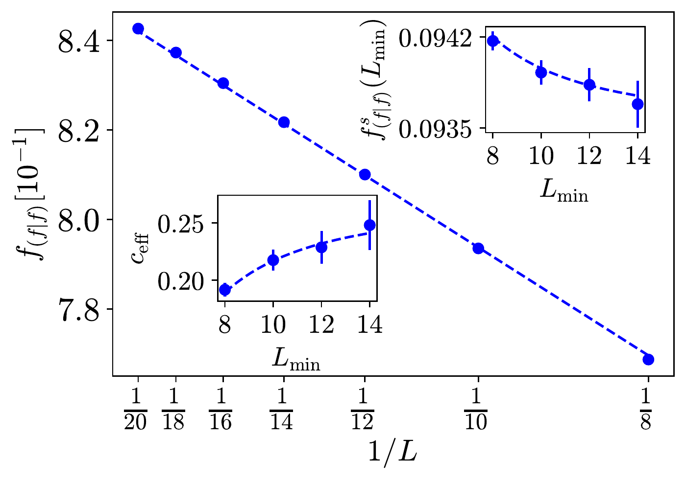
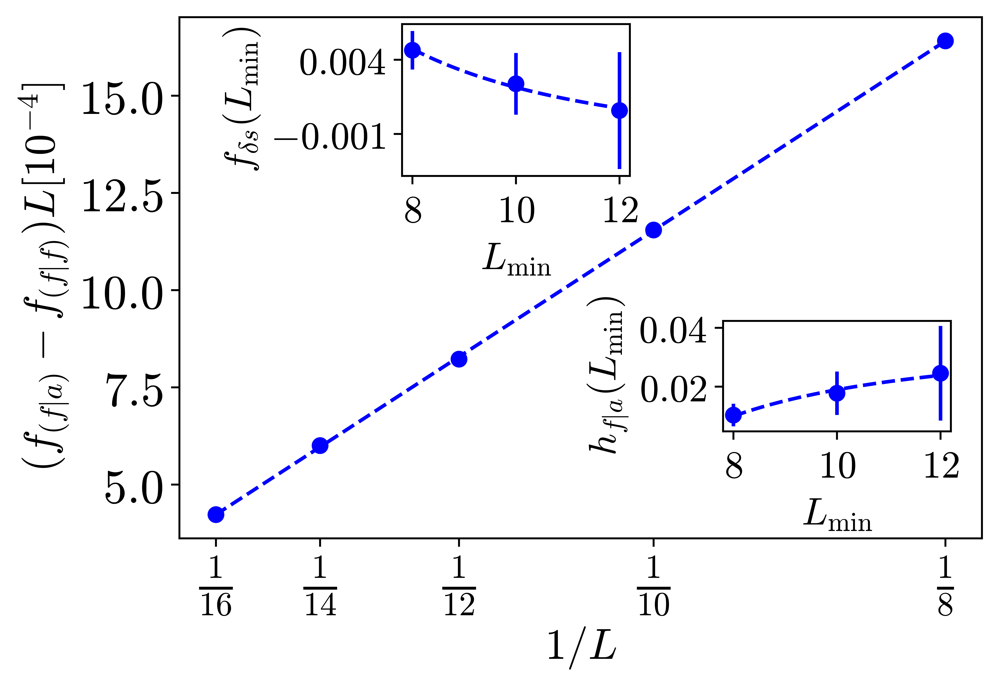
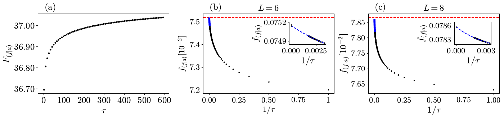

# Figures 6, 7, and 12

[Overview](../README.md) | [Code interfaces](CODE.md) | [Reproducibility](REPRODUCIBILITY.md)

These are Kemal Aziz's contributions as identified by the author. Numbering
follows [arXiv:2310.03078v2](https://arxiv.org/abs/2310.03078v2), by Kumar, Aziz,
Chakraborty, Ludwig, Gopalakrishnan, Pixley, and Vasseur. The other circuit
families in the paper are not represented as this repository's implementation.

## Figure 6: Open-Boundary Free Energy

Open-boundary dual-Haar circuits supply the measurement-record observable.
Finite-size fits separate bulk, surface, and universal contributions.

[Original PDF](figures/fig06.pdf) | [Recovered source](../research/open_boundary_haar.jl)
| [Small driver](../examples/quickstart.jl).

The recovered template computes cumulative record surprisal. The small driver
exercises its dynamics, but does not rerun the production ensemble or fit the
published central charge. Historical batch provenance is incomplete.

## Figure 7: Boundary Dissipation

The difference between dissipative and free-boundary free-energy densities
isolates a boundary contribution. The paper implements boundary dephasing through
Monte Carlo sampling of statevector trajectories.

**Source status:** the original dephasing/Monte Carlo simulation has not yet been
located. The open-boundary code alone cannot reproduce this plot.

The arXiv source asset `fs_fo_extrap.pdf` is actually PNG-encoded despite its
filename. Here it is stored as `fig07.png`, with unchanged bytes and the correct
extension. It is not a regenerated plot or an altered result.

## Figure 12: Monte Carlo Convergence

The Monte Carlo sampling count is extrapolated to remove finite-sampling bias;
small-system density-matrix calculations supply a benchmark.

[Original PDF](figures/fig12.pdf).
**Source status:** the historical Monte Carlo implementation, density-matrix
benchmark, and fitting pipeline remain unconfirmed. They are not replaced by
the example in this repository.

## Availability Summary

| Component | Status |
| --- | --- |
| Original open-boundary dual-Haar statevector template | Recovered from Amarel |
| Short seeded open-boundary example | Runnable, with saved CSV and plot |
| Original Fig. 7/12 statevector Monte Carlo code | Not yet located |
| Production data and final ensemble fits | Not included |
| Published figures 6, 7, 12 | Preserved with [source attribution](figures/README.md) |

These explicit limits prevent a figure gallery from being mistaken for a
complete reproduction package.
